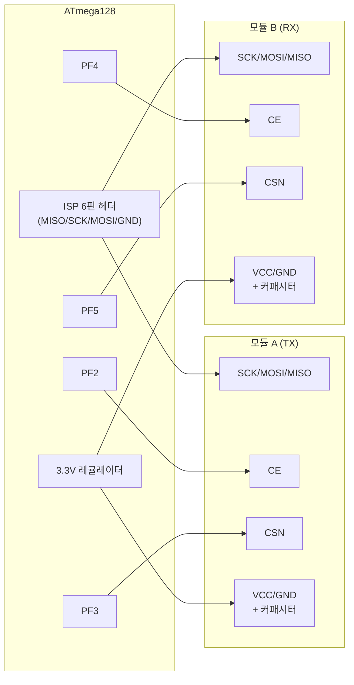
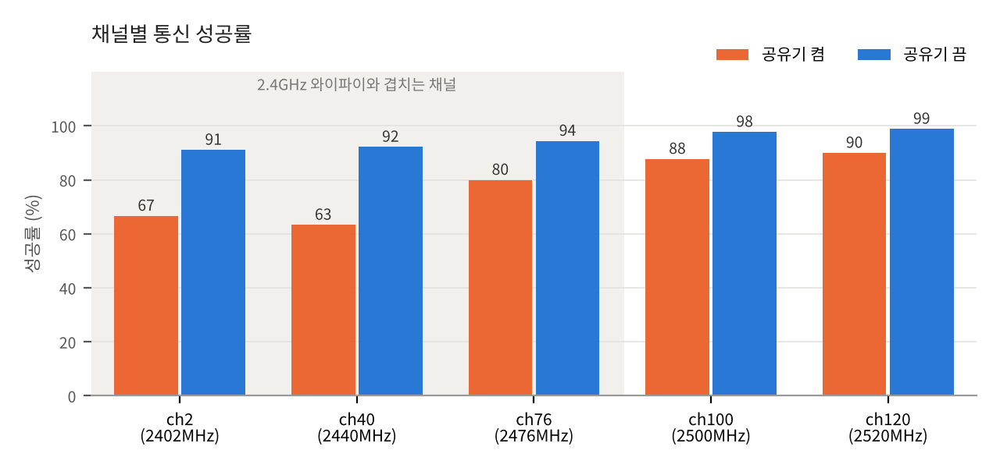
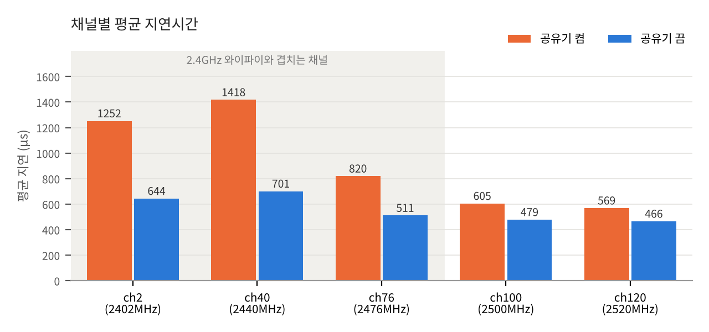

# ATmega128 + nRF24L01 무선통신 지연시간/손실률 측정

ATmega128 보드 1개에 nRF24L01 모듈 2개(TX/RX)를 동시에 연결하여, 채널별 무선통신 지연시간과 패킷 손실률을 측정한 프로젝트입니다.

## 구성

- **MCU**: ATmega128 (Atmel Studio 7.0 프로젝트)
- **무선 모듈**: nRF24L01 x2 (모듈 A = TX, 모듈 B = RX, 하드웨어 Auto-ACK 기능 사용)
- **측정 방식**: Timer1으로 "CE 펄스 시작 ~ ACK 수신 확인(TX_DS)까지" 왕복 지연시간(RTT) 측정
- **출력**: UART(9600bps)로 CSV 형태 결과 출력 → PC에서 로깅/그래프화

## 배선

SPI(SCK/MOSI/MISO)는 두 모듈이 공유하고, CE/CSN 핀만 모듈별로 분리했습니다.

| 신호 | 모듈 A (TX) | 모듈 B (RX) |
|---|---|---|
| CE | PF2 | PF4 |
| CSN | PF3 | PF5 |

- SCK/MOSI/MISO/GND: 보드 ISP 6핀 헤더에서 공통으로 인출 (1=MISO, 2=VCC, 3=SCK, 4=MOSI, 5=RESET, 6=GND)
- 두 모듈 VCC는 3.3V(레귤레이터 경유), GND 공통
- 전원 안정화를 위해 각 모듈 VCC-GND 사이에 100uF (또는 10uF 여러 개 병렬) 커패시터 연결

### 배선도

- SPI(SCK/MOSI/MISO)와 GND는 두 모듈이 공통 버스로 연결되고, CE/CSN만 모듈별 전용 핀으로 분리
- MCU는 CSN으로 어떤 모듈과 통신할지 선택하고, CE로 해당 모듈의 송신/수신 동작을 트리거

## 동작 방식

1. 5개 채널(2, 40, 76, 100, 120)을 순차적으로 스윕
2. 채널마다 30개 패킷(`PACKETS_PER_CHANNEL`)을 20ms 간격으로 전송
3. 패킷마다 시퀀스 번호 + 마커 + XOR 체크섬을 담은 4바이트 payload 전송
4. Auto-ACK 응답 성공 여부와 왕복 지연시간(Timer1 tick, 0.5us 단위)을 기록
5. 채널별로 `channel,total,success,fail,avg_latency_us,plos_cnt,arc_cnt` 형식의 CSV 라인을 UART로 출력
6. 한 사이클(5개 채널) 종료 후 1초 대기하고 무한 반복

`OBSERVE_TX` 레지스터에서 `PLOS_CNT`(누적 패킷 손실), `ARC_CNT`(마지막 전송 재시도 횟수)도 함께 수집합니다.

## 파일 구성

- [latency_test_main.c](latency_test_main.c) — 메인 로직 (UART, Timer1, 채널 스윕, 측정 루프)
- [nrf24l01_v2.c](nrf24l01_v2.c) / [nrf24l01_v2.h](nrf24l01_v2.h) — nRF24L01 SPI 드라이버 (모듈 2개를 동시에 다루도록 구조체 기반으로 설계, CE/CSN 핀만 다르게 지정하면 SPI는 공유)
- `wirelessproject.atsln` / `wirelessproject.cproj` — Atmel Studio 7.0 프로젝트 파일

## 결과 활용

UART로 출력되는 CSV를 PC에서 시리얼로 받아 저장하면, 채널별 평균 지연시간과 패킷 손실률을 비교/그래프화할 수 있습니다.

## 진행 과정과 결과

### 1. 문제 상황
측정 시스템을 완성한 뒤 반복 측정을 진행하던 중, 통신 성공률이 예상보다 낮은 **70%대**에 머무는 현상이 반복되었습니다.
코드 로직 오류인지, 배선 등 하드웨어 문제인지 코드 점검만으로는 원인을 특정하기 어려웠습니다.

### 2. AI를 활용한 원인 후보 정리
AI(Claude)에 실험 구성과 측정 조건을 설명하고, 성공률 저하의 가능한 원인을 질문했습니다.
제시받은 원인 후보는 다음과 같습니다.

- 안테나(모듈) 배치
- 전원 노이즈
- 같은 2.4GHz 대역 안의 무선 간섭

AI의 답은 결론이 아니라 **검증해야 할 가설**로 보고, 후보마다 검증 방법을 함께 정리했습니다.
검증 순서는 실험 환경에서 바로 확인할 수 있는지, 하드웨어적으로 실현 가능한지를 기준으로 정했습니다.

### 3. 검증
- **모듈 배치**: 브레드보드와 점퍼선으로 두 모듈 사이를 약 2m까지 벌리고 위치를 바꿔 가며 측정했지만, 채널에 따른 결과 차이는 그대로였습니다.
- **전원 노이즈**: 각 모듈의 VCC-GND 사이에 커패시터를 달아 전원을 안정화한 상태에서 측정했습니다.
- **대역 내 간섭**: 채널 2, 40, 76, 100, 120을 순서대로 스윕하며 채널당 30개 패킷의 성공 횟수와 지연시간을 비교했습니다.
  그 결과 **와이파이(2.4GHz)와 겹치는 채널에서 성공률이 낮고 지연시간이 길게** 나타났습니다.

이 패턴을 근거로 측정 환경 주변의 **2.4GHz 와이파이 신호를 간섭원**으로 판단했습니다.

### 4. 조치와 결과
간섭원(와이파이 공유기)을 측정 환경에서 치운 뒤 같은 조건으로 다시 측정했습니다.
통신 성공률이 **70%대에서 90%대**로 올라, 간섭이 성공률 저하의 주원인임을 확인했습니다.

간섭이 있을 때 지연시간이 함께 늘어난 이유는, 손상된 패킷에 대해 ACK를 받지 못해 Auto-ACK 재전송이 반복되었기 때문으로 해석했습니다.
(재전송 횟수는 `OBSERVE_TX` 레지스터의 `ARC_CNT`로 함께 확인할 수 있습니다.)

## 측정 결과

채널 2, 40, 76, 100, 120을 순서대로 한 바퀴로 하여 채널당 30패킷씩 3바퀴 측정했습니다. (조건마다 450패킷)
원본 로그는 `results/` 폴더의 CSV 파일입니다.

| 조건 | 성공 / 전체 | 성공률 | 평균 지연 |
|---|---|---|---|
| 공유기 켬 (간섭원 있음) | 349 / 450 | 77.6% | 933 µs |
| 공유기 끔 (간섭원 제거) | 427 / 450 | 94.9% | 560 µs |

- 와이파이 2.4GHz 대역과 겹치는 채널(2, 40, 76)에서 공유기를 켰을 때 성공률이 낮고 지연이 길었습니다.
- 겹치지 않는 채널(100, 120)은 영향이 작았습니다.
- 지연 증가는 손상된 패킷에 대해 ACK를 받지 못해 Auto-ACK 재전송이 반복되었기 때문으로 해석했습니다.

원본 데이터:
- [results/nrf_latency_router.csv](results/nrf_latency_router.csv)
- [results/nrf_latency_without_router.csv](results/nrf_latency_without_router.csv)

### 5. 배운 점
- 무선 품질 문제는 코드만 봐서는 원인을 알기 어렵고, **채널·환경을 바꿔 가며 측정해야** 원인을 가려낼 수 있었습니다.
- AI는 원인 후보를 빠르게 넓혀 주는 데 유용했지만, **진짜 원인은 직접 측정으로 확인**해야 했습니다.
- 같은 대역을 쓰는 다른 무선 신호가 성공률뿐 아니라 재전송을 통해 지연시간까지 악화시킨다는 점을 직접 확인했습니다.
